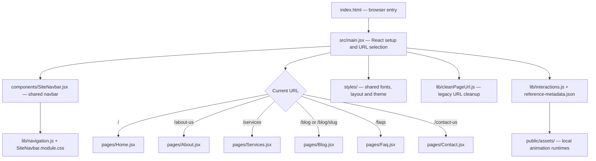
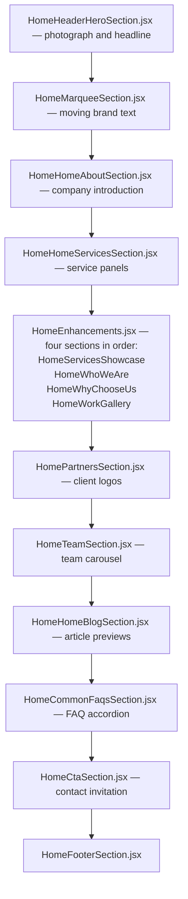
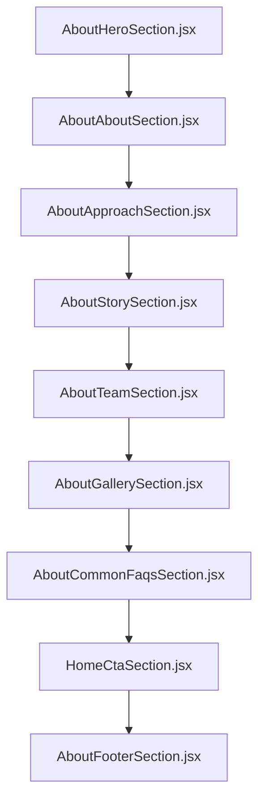
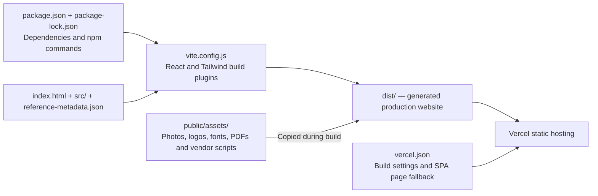

# HI-TECH Protection Security — File Flow

This map describes the current imports and page compositions. Arrows in the first diagram show loading or rendering relationships; arrows in the page diagrams show display order.

## Application entry and page selection

Paths under `pages/`, `components/`, `styles/`, `lib/` and `data/` are relative to `src/`. The app selects pages directly from `location.pathname`; it does not use React Router. `/faq` and `/contact` also work as aliases.

## Homepage section order

All section files below are in `src/components/` and are assembled by `src/pages/Home.jsx`. `SiteNavbar.jsx` is rendered before the page by `main.jsx`.

`HomeTeamSection.jsx` uses `lib/useVisibleSliderHeight.js` to size the carousel to its visible cards.

## About Us section order

`src/pages/About.jsx` assembles these components:

## Other pages

| Page file            | Components and content used, in display order                                                                                                  |
| -------------------- | ---------------------------------------------------------------------------------------------------------------------------------------------- |
| `pages/Services.jsx` | Banner within the page → `HomeHomeServicesSection.jsx` → `HomeCtaSection.jsx` → `AboutFooterSection.jsx`                                       |
| `pages/Blog.jsx`     | Banner → `HomeHomeBlogSection.jsx` for the listing, or article content from `data/blogPosts.js` for a matching slug → `AboutFooterSection.jsx` |
| `pages/Faq.jsx`      | `AboutHeroSection.jsx` → `AboutCommonFaqsSection.jsx` → `AboutFooterSection.jsx`                                                               |
| `pages/Contact.jsx`  | `AboutHeroSection.jsx` → `ContactEnquirySection.jsx` → contact details, map and contact banner within the page → `AboutFooterSection.jsx`      |

The shared navbar appears on all pages. Blog article data is also imported by `main.jsx` to determine the article title. Homepage/listing preview cards currently have their content inside `HomeHomeBlogSection.jsx`.

## Styling files

Global styles are imported by `main.jsx` in this order:

| File                   | Purpose                                                   |
| ---------------------- | --------------------------------------------------------- |
| `styles/fonts.css`     | Local Archivo and DM Sans font declarations               |
| `styles/reference.css` | Base styles, legacy template layouts and responsive rules |
| `styles/app.css`       | Tailwind utilities and application overrides              |
| `styles/layout.css`    | Shared section spacing and homepage layout corrections    |
| `styles/theme.css`     | Shared navy, yellow and cream theme tokens and overrides  |

Component styles are imported directly by their components:

| Component/page                                     | Scoped stylesheet                  |
| -------------------------------------------------- | ---------------------------------- |
| `SiteNavbar.jsx`                                   | `SiteNavbar.module.css`            |
| `HomeHeaderHeroSection.jsx`                        | `HomeHeaderHeroSection.module.css` |
| `HomeEnhancements.jsx`                             | `HomeEnhancements.module.css`      |
| `HomePartnersSection.jsx`                          | `HomePartnersSection.module.css`   |
| `AboutApproachSection.jsx`, `AboutTeamSection.jsx` | `AboutReplacements.module.css`     |
| `AboutGallerySection.jsx`                          | `AboutGallerySection.module.css`   |
| `ContactEnquirySection.jsx`                        | `ContactEnquirySection.module.css` |
| `pages/Contact.jsx`                                | `pages/Contact.module.css`         |
| `pages/Blog.jsx`, `pages/Services.jsx`             | `pages/Blog.module.css`            |

## Assets, build and deployment

| File or directory                                                                                             | Purpose                                                           |
| ------------------------------------------------------------------------------------------------------------- | ----------------------------------------------------------------- |
| `public/assets/hitech/`                                                                                       | Company photographs, logo, client logos and brochure              |
| `public/assets/fonts/`                                                                                        | Locally hosted fonts and licenses                                 |
| `public/assets/home-interactions.js`, `about-interactions.js`                                                 | Retained animation and slider runtimes                            |
| `reference-metadata.json`                                                                                     | Page/site IDs and animation runtime selection                     |
| `asset-manifest.json`                                                                                         | Reference asset mapping; not imported by the current app          |
| `package.json`                                                                                                | Development, build, preview and formatting commands; Node version |
| `package-lock.json`                                                                                           | Locked npm dependency versions                                    |
| `vite.config.js`                                                                                              | Vite development/build plugin configuration                       |
| `vercel.json`                                                                                                 | Vercel build, output directory and page rewrites                  |
| `.nvmrc`                                                                                                      | Node 24 for version managers                                      |
| `.gitignore`, `.vercelignore`                                                                                 | Files excluded from Git or deployment uploads                     |
| `.prettierrc.json`, `.prettierignore`                                                                         | Formatting rules and excluded files                               |
| `.vscode/settings.json`, `.vscode/extensions.json`                                                            | Editor formatting settings and extension recommendation           |
| `README.md`                                                                                                   | Project guide and deployment instructions                         |
| `CONTENT-UPDATE-REPORT.md`, `HOMEPAGE-ENHANCEMENTS.md`, `LAYOUT-AUDIT.md`, `QA.md`, `VISUAL-POLISH-REPORT.md` | Supporting project reports; not runtime inputs                    |
| `tmp/`                                                                                                        | Local working/check files, ignored by Git and deployment          |
| `node_modules/`                                                                                               | Installed dependencies; generated by npm                          |
| `dist/`                                                                                                       | Generated by `npm run build`; edit source files instead           |

## Components currently unused

These files remain in the project but are not imported by the active application:

- `components/HomeTestimonialSection.jsx`
- `components/AboutHeaderSection.jsx` — the active navbar is `SiteNavbar.jsx`.
- `components/AboutAboutChooseSection.jsx`

Keeping a component file in the folder does not display it on the website; a rendered page must import and use it.
